<div align="center">

# 🏎️ DML — Sistema Fórmula 1 | Formula 1 System

**Banco de dados `db_formula1` em MySQL: criação, população e consultas**
**MySQL database `db_formula1`: schema, data population and queries**


🇧🇷 [Português](#-português) • 🇺🇸 [English](#-english)

</div>

---

# 🇧🇷 Português

## 📖 Sobre o projeto

Trabalho em grupo da disciplina de **Modelagem de Dados** em que implementamos, no **MySQL Workbench**, o modelo lógico de um **Sistema de Fórmula 1**: criamos o database `db_formula1`, as 5 tabelas com suas chaves primárias e estrangeiras, populamos todas as tabelas com no mínimo 10 registros e resolvemos as 12 queries propostas pela professora.

## 🎓 Contexto acadêmico

| | |
|---|---|
| **Instituição** | Centro Universitário do Distrito Federal (UDF) |
| **Disciplina** | Modelagem de Dados |
| **Professora** | Profa. MsC Josyane Lannes Florenzano de Souza |
| **Atividade** | Entrega 3 — Trabalho DML em grupo (Sistema Fórmula 1) |
| **SGBD** | MySQL / MySQL Workbench |

## 🗺️ Modelo lógico

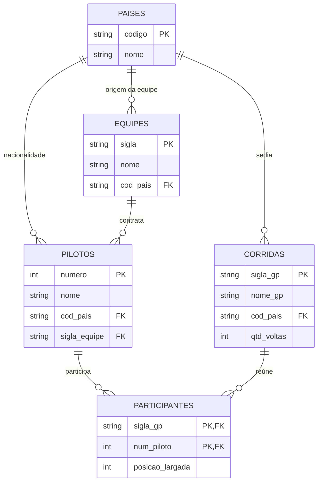

As tabelas foram criadas na ordem das dependências (`paises` → `equipes` → `pilotos` → `corridas` → `participantes`), com as chaves estrangeiras declaradas dentro de cada `CREATE TABLE`. As chaves primárias são códigos com significado no domínio (siglas e número do piloto), por isso **não foi usado `AUTO_INCREMENT`**.

## 📁 Estrutura da pasta

```
03-dml-formula1/
├── README.md
├── db_formula1.sql                     # script completo (DDL + inserts + queries)
└── docs/
    ├── Trabalho_DML_Formula1_Grupo.pdf # relatório entregue à professora
    └── screenshots/                    # resultado de cada query no MySQL Workbench
        ├── 01-pilotos-por-pais.png
        ├── 02-contagem-registros-tabelas.png
        ├── 03-paises-b-l.png
        ├── 04-pilotos-brasil-italia-franca.png
        ├── 05-nome-pilotos.png
        ├── 06-gps-e-voltas-alias.png
        ├── 07-pilotos-e-paises-join.png
        ├── 08-alter-table-salario.png
        ├── 09-update-salarios.png
        ├── 10-salarios-entre-70-e-100-mil.png
        ├── 11-media-salarial-por-pais.png
        └── 12-salarios-distintos.png
```

## ▶️ Como executar

1. Abra o **MySQL Workbench** e conecte-se a uma instância local do MySQL.
2. Vá em **File → Open SQL Script** e selecione `db_formula1.sql`.
3. Execute o script inteiro com **`Ctrl + Shift + Enter`**.
4. Os resultados das queries aparecem nas abas de resultado, na ordem do script.

> ⚠️ O script começa com `DROP DATABASE IF EXISTS db_formula1;`. Ele apaga e recria o banco do zero, o que permite rodá-lo várias vezes. Se você já tiver um banco com esse nome e dados próprios, faça um backup antes.

## 🗃️ Dados inseridos

| Tabela | Registros |
|---|:---:|
| `paises` | 16 |
| `equipes` | 12 |
| `pilotos` | 15 (6 do Brasil, 3 da Itália, 4 da França, 1 dos Países Baixos e 1 do Reino Unido) |
| `corridas` | 11 |
| `participantes` | 40 |

## 🔎 Queries

| # | Enunciado | Conceitos | Resultado |
|:---:|---|---|---|
| 01 | Inserir no mínimo 5 pilotos do Brasil, 3 da Itália e 2 da França (conferência) | `JOIN`, `GROUP BY`, `COUNT` | [print](docs/screenshots/01-pilotos-por-pais.png) |
| 02 | Popular todas as tabelas (conferência) | `UNION ALL`, `COUNT` | [print](docs/screenshots/02-contagem-registros-tabelas.png) |
| 03 | Países que começam com B e terminam com L | `LIKE 'B%L'` | [print](docs/screenshots/03-paises-b-l.png) |
| 04 | Pilotos do Brasil, Itália e França | subconsulta, `IN` | [print](docs/screenshots/04-pilotos-brasil-italia-franca.png) |
| 05 | Nome dos pilotos | `SELECT` | [print](docs/screenshots/05-nome-pilotos.png) |
| 06 | Nome dos GPs e quantidade de voltas | `ALIAS (AS)` | [print](docs/screenshots/06-gps-e-voltas-alias.png) |
| 07 | Nome dos pilotos e seus países | `JOIN` | [print](docs/screenshots/07-pilotos-e-paises-join.png) |
| 08 | Inserir o atributo salário na tabela pilotos | `ALTER TABLE` | [print](docs/screenshots/08-alter-table-salario.png) |
| 09 | Popular o atributo salário | `UPDATE` | [print](docs/screenshots/09-update-salarios.png) |
| 10 | Pilotos com salário entre 70 e 100 mil | `BETWEEN` | [print](docs/screenshots/10-salarios-entre-70-e-100-mil.png) |
| 11 | Média salarial para cada `cod_pais` | `AVG`, `GROUP BY` | [print](docs/screenshots/11-media-salarial-por-pais.png) |
| 12 | Salários distintos em ordem crescente | `DISTINCT`, `ORDER BY` | [print](docs/screenshots/12-salarios-distintos.png) |

<details>
<summary><b>📸 Ver os resultados no MySQL Workbench</b></summary>

<br>

**01 — Pilotos por país**
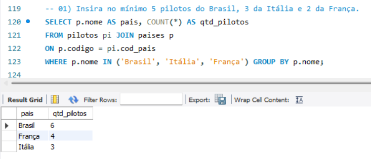

**02 — Registros por tabela**
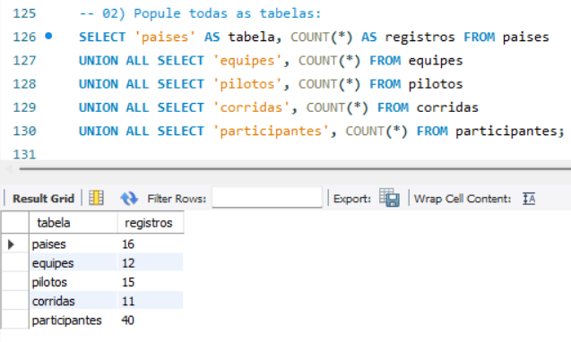

**03 — Países que começam com B e terminam com L**
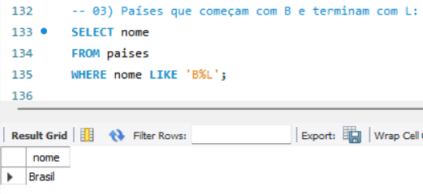

**04 — Pilotos do Brasil, Itália e França**
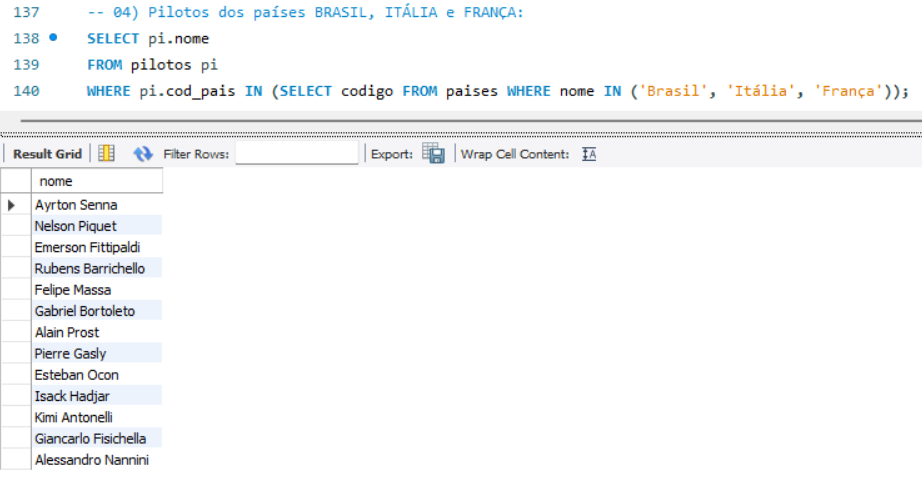

**05 — Nome dos pilotos**
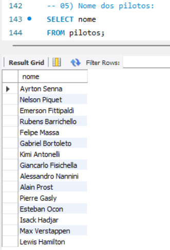

**06 — GPs e quantidade de voltas (ALIAS)**
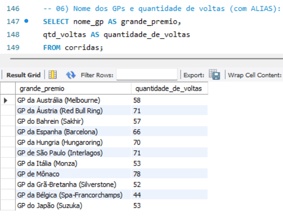

**07 — Pilotos e seus países (JOIN)**
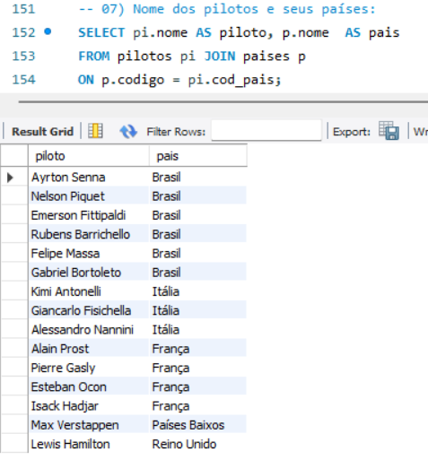

**08 — Adicionando a coluna salário**
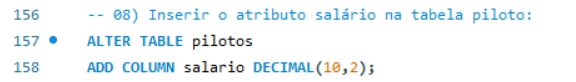

**09 — Populando os salários**
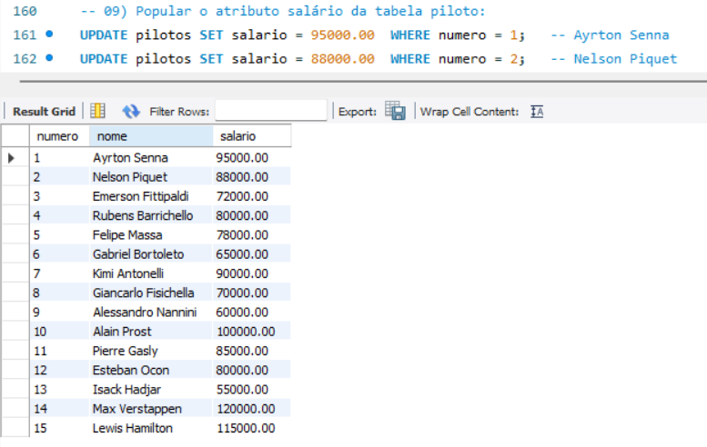

**10 — Salários entre 70 e 100 mil**
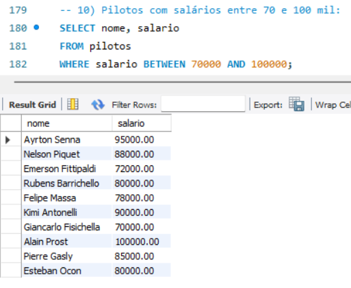

**11 — Média salarial por país**
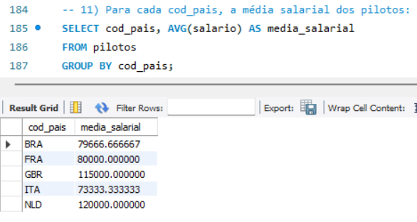

**12 — Salários distintos em ordem crescente**
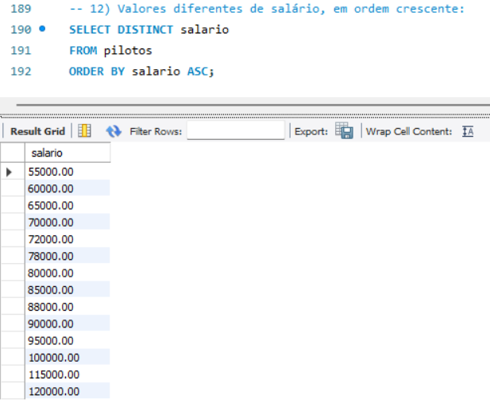

</details>

## 📝 Observações

- Os dados têm **finalidade exclusivamente didática**. Os pilotos e as equipes são reais, mas de épocas diferentes (por exemplo, Ayrton Senna e Max Verstappen no mesmo banco), e **os salários são fictícios**.
- O `numero` do piloto é um identificador sequencial criado para o exercício, e não o número oficial do carro.
- O enunciado da query 11 fala em "empregados"; no modelo, os empregados são os **pilotos**.

## 👥 Integrantes

| Integrante | GitHub |
|---|---|
| Bernardo Kopp Pinheiro | [@bernardokoppdev](https://github.com/bernardokoppdev) |
| Gabriel Valois Rodrigues | [@valoardev](https://github.com/valoardev) |
| Pedro Henrique Lima dos Santos Mota | [@pedrohenrmt](https://github.com/pedrohenrmt) |
| Piêtro Bitencourt Nunes | [@pietrobitencourt](https://github.com/pietrobitencourt) |
| Zamorano Fragoso de Sousa | [@zamfs](https://github.com/zamfs) |

---

# 🇺🇸 English

## 📖 About the project

Group assignment for the **Data Modeling** course. Using **MySQL Workbench**, we implemented the logical model of a **Formula 1 System**: we created the `db_formula1` database and its 5 tables with primary and foreign keys, populated every table with at least 10 records, and solved the 12 queries assigned by the professor.

## 🎓 Academic context

| | |
|---|---|
| **Institution** | Centro Universitário do Distrito Federal (UDF) |
| **Course** | Data Modeling (Modelagem de Dados) |
| **Professor** | Profa. MsC Josyane Lannes Florenzano de Souza |
| **Assignment** | Delivery 3 — Group DML assignment (Formula 1 System) |
| **DBMS** | MySQL / MySQL Workbench |

## 🗺️ Logical model

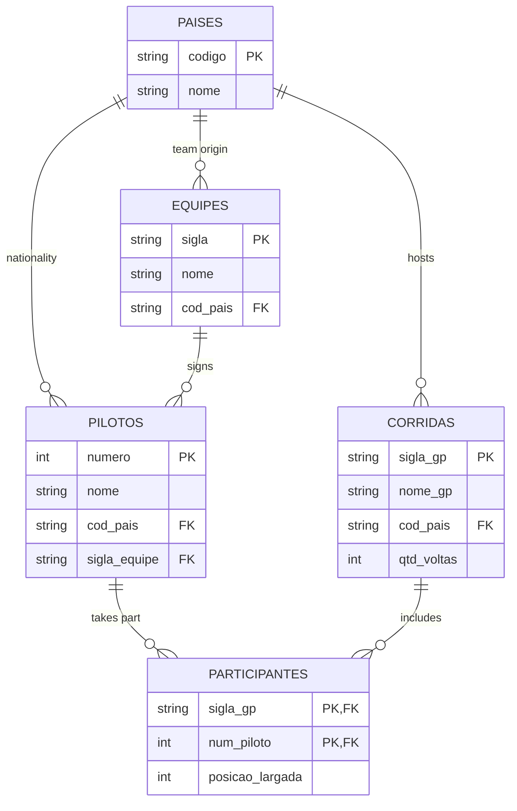

Table and column names are kept in Portuguese, as in the model provided for the course (`paises` = countries, `equipes` = teams, `pilotos` = drivers, `corridas` = races, `participantes` = participants).

Tables were created in dependency order (`paises` → `equipes` → `pilotos` → `corridas` → `participantes`), with foreign keys declared inside each `CREATE TABLE`. Primary keys are meaningful domain codes (abbreviations and the driver number), so **`AUTO_INCREMENT` was not used**.

## 📁 Folder structure

```
03-dml-formula1/
├── README.md
├── db_formula1.sql                     # full script (DDL + inserts + queries)
└── docs/
    ├── Trabalho_DML_Formula1_Grupo.pdf # report delivered to the professor (in Portuguese)
    └── screenshots/                    # result of each query in MySQL Workbench
        ├── 01-pilotos-por-pais.png
        ├── 02-contagem-registros-tabelas.png
        ├── 03-paises-b-l.png
        ├── 04-pilotos-brasil-italia-franca.png
        ├── 05-nome-pilotos.png
        ├── 06-gps-e-voltas-alias.png
        ├── 07-pilotos-e-paises-join.png
        ├── 08-alter-table-salario.png
        ├── 09-update-salarios.png
        ├── 10-salarios-entre-70-e-100-mil.png
        ├── 11-media-salarial-por-pais.png
        └── 12-salarios-distintos.png
```

## ▶️ How to run

1. Open **MySQL Workbench** and connect to a local MySQL instance.
2. Go to **File → Open SQL Script** and select `db_formula1.sql`.
3. Run the whole script with **`Ctrl + Shift + Enter`**.
4. Query results show up in the result tabs, in the order of the script.

> ⚠️ The script starts with `DROP DATABASE IF EXISTS db_formula1;`. It drops and recreates the database from scratch, so it can be run multiple times. If you already have a database with that name and your own data, back it up first.

## 🗃️ Inserted data

| Table | Records |
|---|:---:|
| `paises` | 16 |
| `equipes` | 12 |
| `pilotos` | 15 (6 from Brazil, 3 from Italy, 4 from France, 1 from the Netherlands and 1 from the United Kingdom) |
| `corridas` | 11 |
| `participantes` | 40 |

## 🔎 Queries

| # | Task | Concepts | Result |
|:---:|---|---|---|
| 01 | Insert at least 5 drivers from Brazil, 3 from Italy and 2 from France (check) | `JOIN`, `GROUP BY`, `COUNT` | [screenshot](docs/screenshots/01-pilotos-por-pais.png) |
| 02 | Populate all tables (check) | `UNION ALL`, `COUNT` | [screenshot](docs/screenshots/02-contagem-registros-tabelas.png) |
| 03 | Countries starting with B and ending with L | `LIKE 'B%L'` | [screenshot](docs/screenshots/03-paises-b-l.png) |
| 04 | Drivers from Brazil, Italy and France | subquery, `IN` | [screenshot](docs/screenshots/04-pilotos-brasil-italia-franca.png) |
| 05 | Driver names | `SELECT` | [screenshot](docs/screenshots/05-nome-pilotos.png) |
| 06 | Grand Prix names and number of laps | `ALIAS (AS)` | [screenshot](docs/screenshots/06-gps-e-voltas-alias.png) |
| 07 | Driver names and their countries | `JOIN` | [screenshot](docs/screenshots/07-pilotos-e-paises-join.png) |
| 08 | Add the salary attribute to the drivers table | `ALTER TABLE` | [screenshot](docs/screenshots/08-alter-table-salario.png) |
| 09 | Populate the salary attribute | `UPDATE` | [screenshot](docs/screenshots/09-update-salarios.png) |
| 10 | Drivers earning between 70 and 100 thousand | `BETWEEN` | [screenshot](docs/screenshots/10-salarios-entre-70-e-100-mil.png) |
| 11 | Average salary for each `cod_pais` | `AVG`, `GROUP BY` | [screenshot](docs/screenshots/11-media-salarial-por-pais.png) |
| 12 | Distinct salaries in ascending order | `DISTINCT`, `ORDER BY` | [screenshot](docs/screenshots/12-salarios-distintos.png) |

<details>
<summary><b>📸 See the results in MySQL Workbench</b></summary>

<br>

**01 — Drivers per country**


**02 — Records per table**


**03 — Countries starting with B and ending with L**


**04 — Drivers from Brazil, Italy and France**


**05 — Driver names**


**06 — Grand Prix and number of laps (ALIAS)**


**07 — Drivers and their countries (JOIN)**


**08 — Adding the salary column**


**09 — Populating salaries**


**10 — Salaries between 70 and 100 thousand**


**11 — Average salary per country**


**12 — Distinct salaries in ascending order**


</details>

## 📝 Notes

- The data is for **educational purposes only**. Drivers and teams are real but from different eras (for example, Ayrton Senna and Max Verstappen in the same database), and **salaries are fictional**.
- The driver `numero` is a sequential identifier created for the exercise, not the official car number.
- The wording of query 11 mentions "employees"; in this model, the employees are the **drivers**.

## 👥 Team

| Member | GitHub |
|---|---|
| Bernardo Kopp Pinheiro | [@bernardokoppdev](https://github.com/bernardokoppdev) |
| Gabriel Valois Rodrigues | [@valoardev](https://github.com/valoardev) |
| Pedro Henrique Lima dos Santos Mota | [@pedrohenrmt](https://github.com/pedrohenrmt) |
| Piêtro Bitencourt Nunes | [@pietrobitencourt](https://github.com/pietrobitencourt) |
| Zamorano Fragoso de Sousa | [@zamfs](https://github.com/zamfs) |
