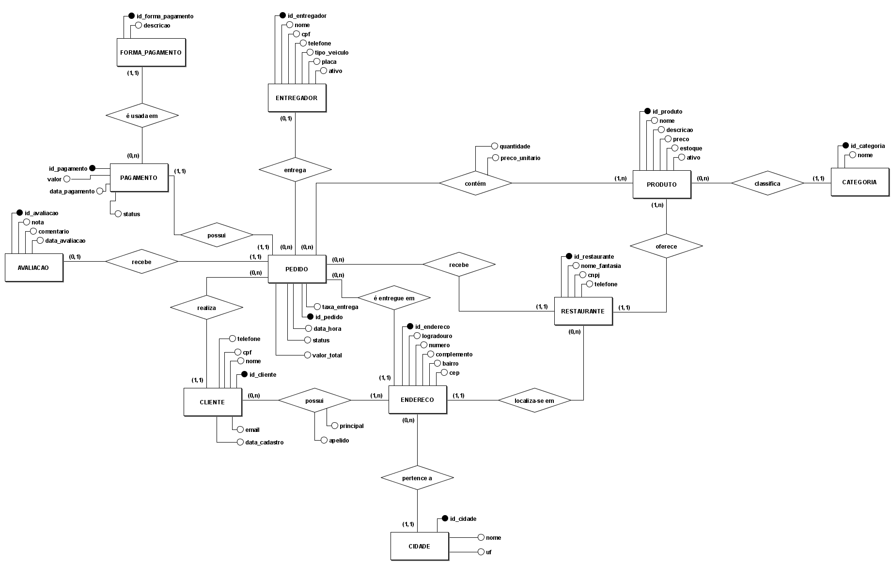
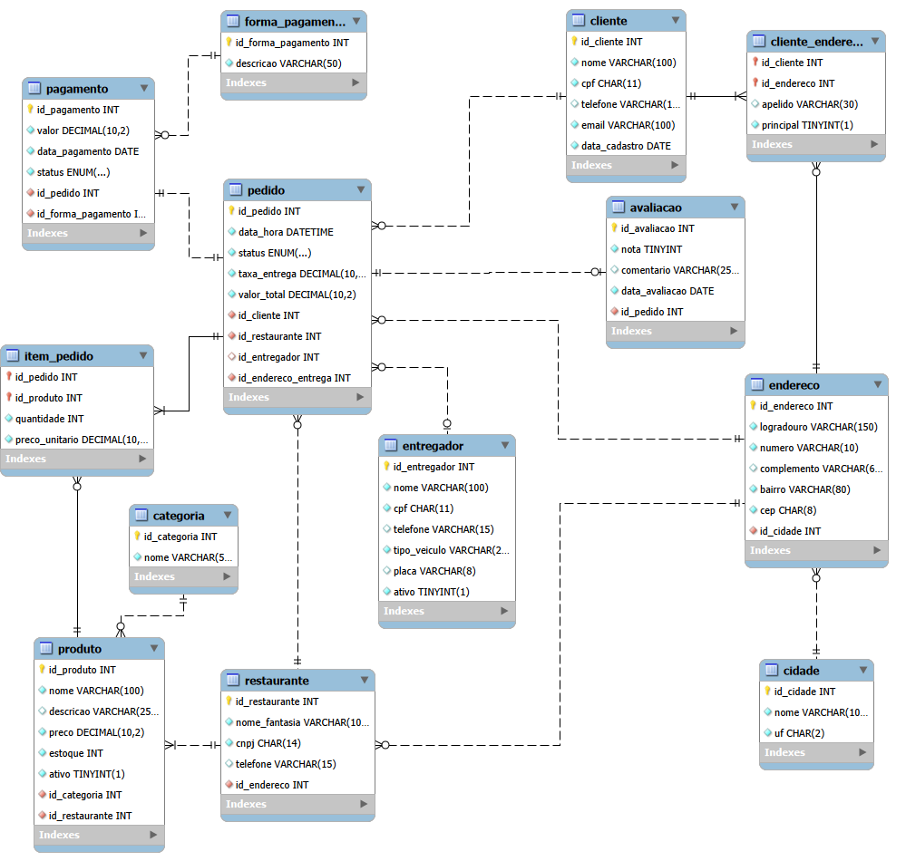

<div align="center">

# 🍽️ Delivery de Restaurante
### Projeto Final de Modelagem de Banco de Dados · *Final Project – Database Modeling*


[🇧🇷 Português](#-português) · [🇺🇸 English](#-english)

</div>

---

# 🇧🇷 Português

## 📌 Sobre o projeto

Banco de dados relacional de um **sistema de delivery de restaurantes**, que conecta clientes, restaurantes parceiros e entregadores.
O projeto cobre todas as etapas: **modelagem conceitual** (MER), **modelagem lógica** (DER), **modelagem física** (script SQL em MySQL 8) e **26 consultas SQL**, incluindo *triggers* e *stored procedures*.

| | |
|---|---|
| **Instituição** | Centro Universitário do Distrito Federal (UDF) |
| **Disciplina** | Modelagem de Banco de Dados |
| **Professora** | MsC Josyane Lannes Florenzano de Souza |
| **Tipo** | Trabalho em grupo (projeto final, 2,0 pontos) |

## 👥 Integrantes

- Bernardo Kopp Pinheiro
- Gabriel Valois Rodrigues
- Pedro Henrique Lima dos Santos Mota
- Piêtro Bitencourt Nunes ([@pietrobitencourt](https://github.com/pietrobitencourt))
- Zamorano Fragoso de Sousa

## 📂 Estrutura da pasta

```
04-projeto-final-delivery-restaurante/
├── README.md
├── docs/
│   ├── Projeto_Final_BD_Delivery_Restaurante.pdf   # documento completo entregue
│   └── screenshots/
│       ├── execucao/                               # criação das tabelas, carga de dados e triggers
│       └── consultas/                              # resultado de cada consulta (B1..B6, I1..I15, A3..A5)
├── modelagem/
│   ├── conceitual/                                 # MER (BRModelo): .brM3 e .png
│   └── logico/                                     # DER (MySQL Workbench): .mwb e .png
└── sql/
    ├── 01_schema_delivery.sql                      # DDL: banco e 13 tabelas
    ├── 02_dados_delivery.sql                       # DML: dados de exemplo
    └── 03_consultas_delivery.sql                   # consultas, triggers e procedures
```

## 🧩 Modelos

### Modelo conceitual (MER – BRModelo)

11 entidades e 13 relacionamentos, com cardinalidades em **leitura cruzada** (*look across*).



### Modelo lógico (DER – MySQL Workbench)

13 tabelas (11 entidades + 2 tabelas associativas: `cliente_endereco` e `item_pedido`).



## 🗄️ Tabelas

| Tabela | Descrição |
|---|---|
| `cidade`, `endereco` | Localização, reutilizada por clientes, restaurantes e entregas |
| `cliente`, `cliente_endereco` | Clientes e seus vários endereços (N:N) |
| `restaurante`, `categoria`, `produto` | Restaurantes parceiros e cardápio |
| `entregador` | Entregadores e veículos |
| `pedido`, `item_pedido` | Pedidos e seus itens (N:N com produto) |
| `forma_pagamento`, `pagamento` | Pagamento do pedido (1:1) |
| `avaliacao` | Avaliação opcional do pedido entregue (1:1 opcional) |

## ▶️ Como executar

Requisito: **MySQL 8.0.16 ou superior** (para que as restrições `CHECK` sejam aplicadas). Execute **nesta ordem**:

1. `sql/01_schema_delivery.sql` — recria o banco `delivery_restaurante` e as tabelas.
2. `sql/02_dados_delivery.sql` — insere os dados de exemplo.
3. `sql/03_consultas_delivery.sql` — consultas, triggers e procedures.

**No MySQL Workbench:** *File → Open SQL Script…* e execute cada arquivo (raio ⚡).
**Pelo terminal:**

```bash
mysql -u root -p < sql/01_schema_delivery.sql
mysql -u root -p < sql/02_dados_delivery.sql
mysql -u root -p < sql/03_consultas_delivery.sql
```

> ⚠️ O script 01 usa `DROP DATABASE IF EXISTS delivery_restaurante` e apaga os dados anteriores desse banco.
> Os triggers só devem ser criados **depois** da carga de dados (o `valor_total` dos pedidos já vem calculado).

## 🔎 Consultas

**26 consultas**: 6 básicas, 15 intermediárias e 5 avançadas. Os resultados estão em [`docs/screenshots/consultas`](docs/screenshots/consultas).

### Básicas

| Código | Descrição |
|---|---|
| B1 | Listar todos os dados de todos os clientes. |
| B2 | Listar apenas nome, telefone e e-mail dos clientes. |
| B3 | Mostrar o cardápio completo (nome e preço dos produtos). |
| B4 | Listar os restaurantes cadastrados. |
| B5 | Listar os entregadores e seus veículos. |
| B6 | Listar os pedidos com data, status e valor total. |

### Intermediárias

| Código | Descrição |
|---|---|
| I1 | Quais tipos de veículo os entregadores usam (sem repetição)? |
| I2 | Valor em estoque de cada produto ativo e preço promocional com 10% de desconto. |
| I3 | Produtos ativos caros (a partir de R$ 50) ou com estoque baixo (menos de 30), exceto bebidas. |
| I4 | Buscar produtos de pizza ou lanches "X-". |
| I5 | Pedidos feitos em outubro de 2026. |
| I6 | Pedidos que ainda estão em andamento. |
| I7 | Resumo financeiro dos pedidos entregues: quantidade, faturamento, ticket médio, maior e menor pedido. |
| I8 | Pedidos com cliente, restaurante, bairro e cidade de entrega. |
| I9 | Os 5 produtos mais vendidos (em unidades), desconsiderando cancelados. |
| I10 | Restaurantes com faturamento (pedidos entregues) acima de R$ 500. |
| I11 | Nota média e quantidade de avaliações de cada restaurante. |
| I12 | Produtos ativos com preço acima da média de preços. |
| I13 | Clientes que nunca fizeram um pedido. |
| I14 | Entregas concluídas por entregador, incluindo quem nunca entregou. |
| I15 | Agenda de contatos: nome e telefone de clientes e entregadores. |

### Avançadas (Triggers e Stored Procedures)

| Código | Objeto | Descrição |
|---|---|---|
| A1 | Trigger `trg_item_valida_antes_inserir` | Antes de inserir um item, valida produto ativo, restaurante do pedido e estoque |
| A2 | Trigger `trg_item_apos_inserir` | Após inserir um item, baixa o estoque e recalcula o `valor_total` do pedido |
| A3 | Trigger `trg_pedido_cancelado_devolve_estoque` | Ao cancelar um pedido, devolve os itens ao estoque |
| A4 | Procedure `sp_adicionar_item` | Adiciona um produto ao pedido usando o preço atual |
| A5 | Procedure `sp_faturamento_restaurante` | Relatório de faturamento de um restaurante em um período |

## 📝 Observações

- Todos os dados (nomes, CPFs, CNPJs, telefones e e-mails) são **fictícios**, criados apenas para fins didáticos.
- O documento completo, com a descrição do cenário, o passo a passo da modelagem e a explicação de cada comando, está em [`docs/Projeto_Final_BD_Delivery_Restaurante.pdf`](docs/Projeto_Final_BD_Delivery_Restaurante.pdf).
- Projeto acadêmico. Consulte o arquivo `LICENSE` na raiz do repositório.

---

# 🇺🇸 English

## 📌 About

Relational database for a **restaurant delivery system** that connects customers, partner restaurants and couriers.
The project covers every stage: **conceptual modeling** (ER model), **logical modeling** (ER diagram), **physical modeling** (MySQL 8 SQL script) and **26 SQL queries**, including *triggers* and *stored procedures*.

| | |
|---|---|
| **Institution** | Centro Universitário do Distrito Federal (UDF) |
| **Course** | Database Modeling (*Modelagem de Banco de Dados*) |
| **Professor** | MsC Josyane Lannes Florenzano de Souza |
| **Type** | Group final project (2.0 points) |

## 👥 Team

- Bernardo Kopp Pinheiro
- Gabriel Valois Rodrigues
- Pedro Henrique Lima dos Santos Mota
- Piêtro Bitencourt Nunes ([@pietrobitencourt](https://github.com/pietrobitencourt))
- Zamorano Fragoso de Sousa

## 🧩 Models

- **Conceptual model (ER, BRModelo):** 11 entities and 13 relationships, with *look-across* cardinalities — see [`modelagem/conceitual`](modelagem/conceitual).
- **Logical model (ER diagram, MySQL Workbench):** 13 tables (11 entities + 2 associative tables: `cliente_endereco` and `item_pedido`) — see [`modelagem/logico`](modelagem/logico).

## ▶️ How to run

Requires **MySQL 8.0.16 or later** (so that `CHECK` constraints are enforced). Run the scripts **in this order**:

1. `sql/01_schema_delivery.sql` — recreates the `delivery_restaurante` database and its 13 tables.
2. `sql/02_dados_delivery.sql` — inserts the sample data.
3. `sql/03_consultas_delivery.sql` — queries, triggers and procedures.

```bash
mysql -u root -p < sql/01_schema_delivery.sql
mysql -u root -p < sql/02_dados_delivery.sql
mysql -u root -p < sql/03_consultas_delivery.sql
```

> ⚠️ Script 01 runs `DROP DATABASE IF EXISTS delivery_restaurante` and erases any previous data in that database.
> Create the triggers only **after** loading the data (each order's `valor_total` is already computed).

## 🔎 Queries

**26 queries:** 6 basic (`SELECT`, `FROM`, aliases), 15 intermediate (`DISTINCT`, calculated columns, `LIKE`, `BETWEEN`, `IN`, aggregate functions, `INNER`/`LEFT JOIN`, `GROUP BY`, `HAVING`, `ORDER BY`/`LIMIT`, subqueries, `UNION`) and 5 advanced (3 triggers and 2 stored procedures that validate items, update stock and order totals, and generate a revenue report). Results are in [`docs/screenshots/consultas`](docs/screenshots/consultas).

## 📝 Notes

- All data (names, tax IDs, phone numbers and e-mails) is **fictitious**, created for educational purposes only.
- The full report (in Portuguese), with the scenario description, the modeling steps and an explanation of every SQL command, is in [`docs/Projeto_Final_BD_Delivery_Restaurante.pdf`](docs/Projeto_Final_BD_Delivery_Restaurante.pdf).
- Academic project. See the `LICENSE` file at the repository root.
